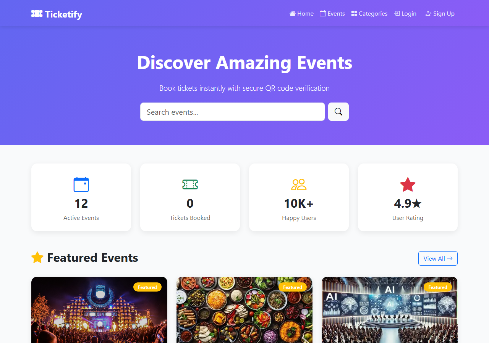
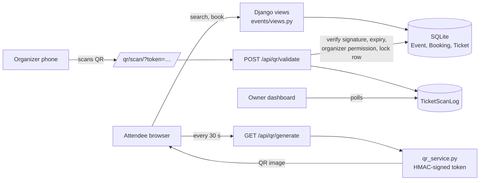
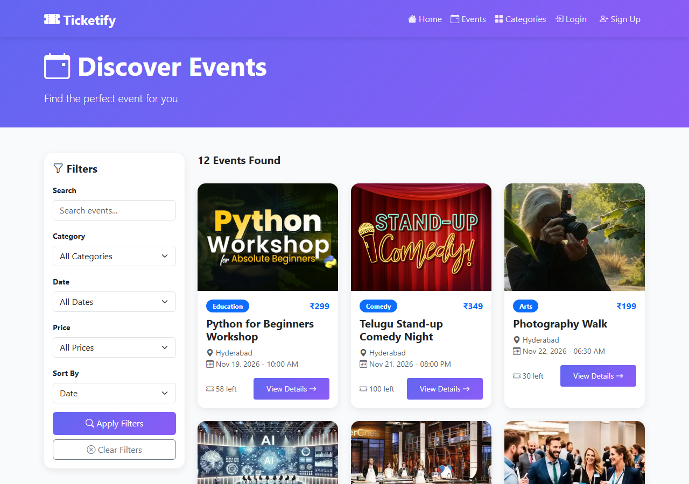
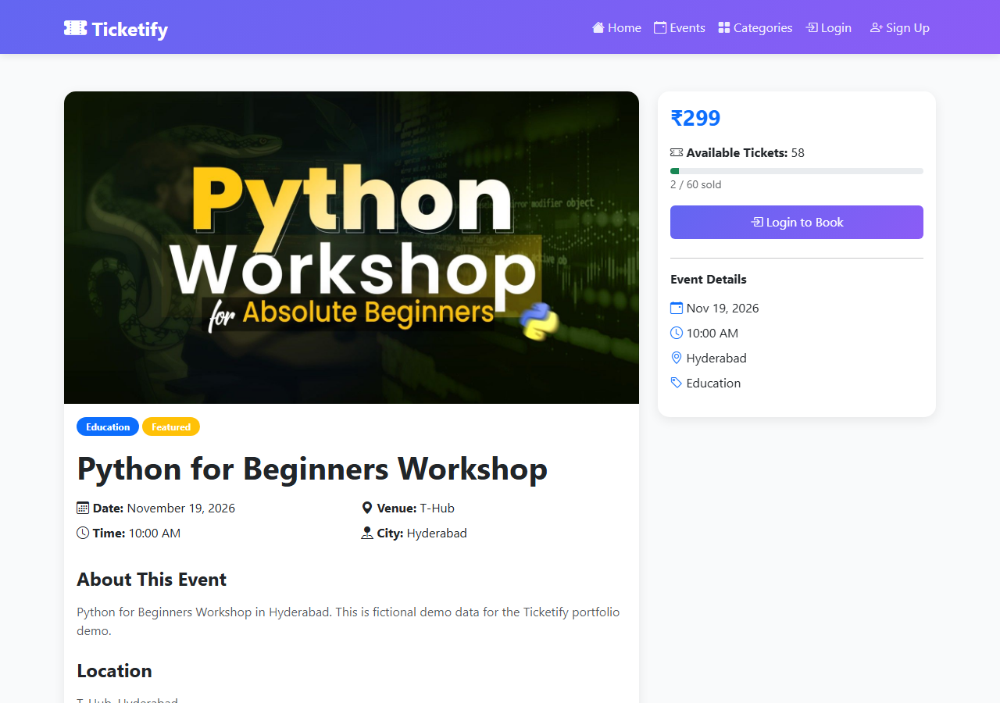
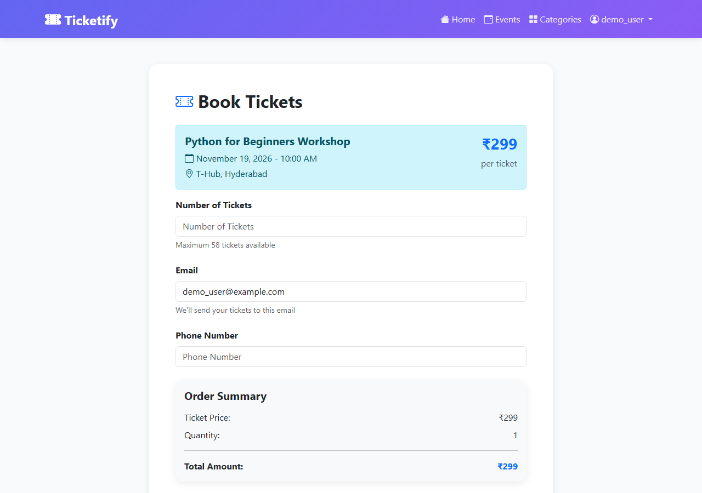
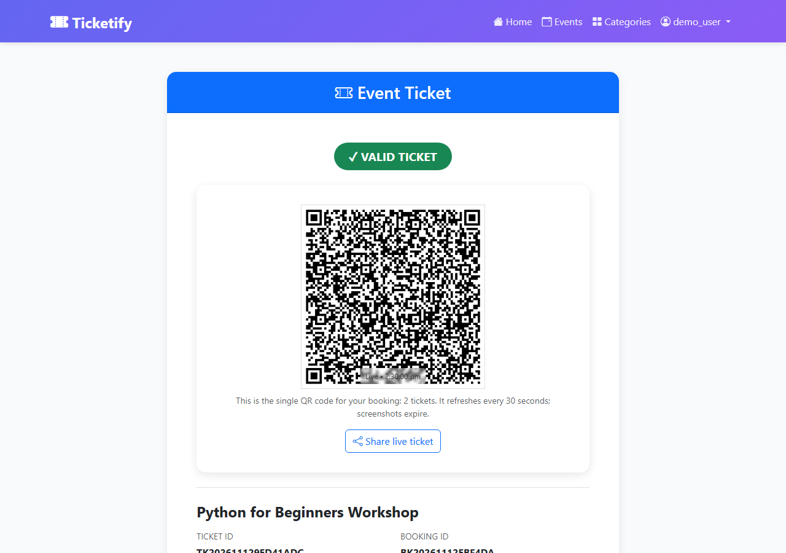
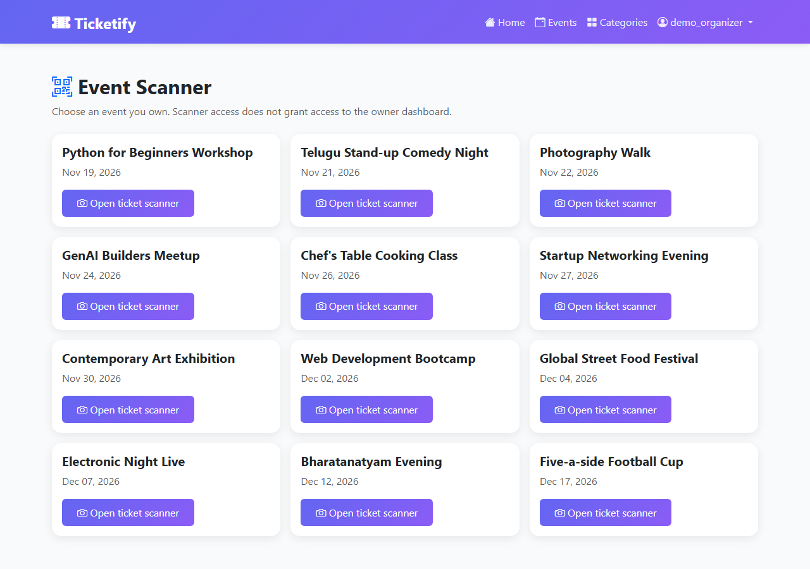
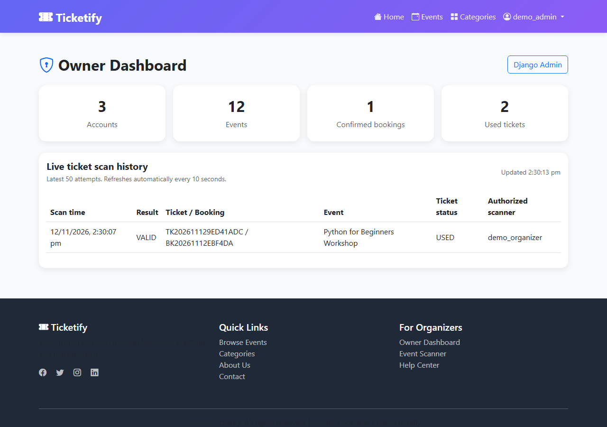
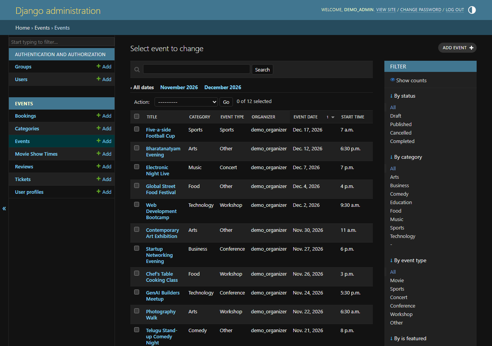
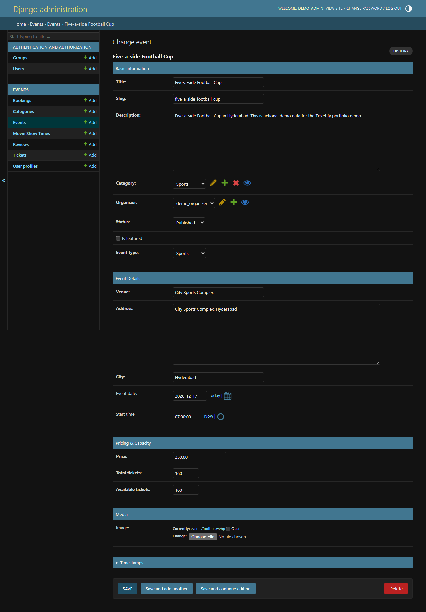

# 🎟️ Ticketify — Event Ticket Booking Platform

A Django web application for discovering events, booking tickets and checking attendees in with **rotating, signed QR codes**.


> **Related project:** [Ticketify AI Chatbot](https://github.com/Aarthi23115/Ticketify-AI-Chatbot) is a Flask + Google Gemini assistant that answers questions about this codebase.



---

## Problem statement

Small event organizers often sell tickets through chat messages and spreadsheets, then check people in from a printed list. That makes it easy to forge or reuse a ticket, hard to know how many seats are left, and slow at the entrance.

Ticketify puts the whole flow in one place:
- Attendees find an event, book seats and get a QR ticket.
- Organizers manage their events and validate each ticket at the door, and a ticket cannot be used twice.

## Features

All of the features below exist in the code.

### Attendees
- **Account:** register, log in and log out.
- **Browse events:** search by title, description, city, venue or category, and filter by category, date (today, tomorrow, this weekend, upcoming) and free or paid.
- **Sort and page:** sort results by date, price or popularity; pages of 12.
- **Book tickets:** choose the quantity, seats and, for movies, a show time. The quantity is checked against the seats left.
- **Booking IDs:** a unique booking ID (`BK…`) and one ticket per seat (`TK…`).
- **Live QR ticket:** the QR code refreshes every 30 seconds, so a screenshot stops working.
- **Share link:** a signed share link lets a friend open the live ticket without logging in.
- **History:** "My bookings" and "My tickets" pages.
- **Reviews:** rate an event 1–5★, only if you hold a ticket for it.

### Organizers
- **Manage events:** create, edit and delete your own events (title, category, venue, city, date and time, price, capacity, image).
- **Bookings:** see the bookings list for each event.
- **Scan at the entrance:** an event scanner page, plus a scan link that **only the event's organizer** (or the site owner) can use to check a ticket in.
- **Manual check-in:** validate a ticket by its verification code.

### Site owner / admin
- **Owner dashboard:** account, event, booking and used-ticket counts, plus a live **scan history** that refreshes every 10 seconds.
- **Django admin:** manage users, categories, events (with *Event details*, *Pricing & capacity* and *Media* sections), movie show times, bookings, tickets and reviews.

### Ticket security (how the QR check works)
- **Signed tokens:** each QR holds a token signed with HMAC-SHA256 (`events/services/qr_service.py`). The token is valid for one refresh window (30 s by default).
- **Server checks:** the validation API (`POST /api/qr/validate/`) checks the signature, expiry and the organizer's permission, then rate-limits attempts per ticket and IP.
- **No double check-in:** the booking is locked in the database during check-in, so the same ticket cannot be admitted twice, even by two scanners at once.
- **Audit log:** every scan attempt, successful or not, is saved in `TicketScanLog`.

## Tech stack

| Layer | Technology |
|---|---|
| Language | Python 3.11+ |
| Web framework | Django 5.2 (templates, auth, admin, ORM) |
| API | Django REST Framework (QR generate and validate endpoints) |
| Database | SQLite (development and demo) |
| QR codes | `qrcode` + Pillow |
| Cache | Django local-memory cache, or Redis when `REDIS_URL` is set |
| Frontend | Django templates, Bootstrap 5, Bootstrap Icons, vanilla JavaScript |
| Testing | Django `TestCase` (43 tests) |

## Architecture and workflow



1. The **attendee** books seats. The booking and its tickets are saved, and the seats left go down.
2. The **ticket page** asks the API for a fresh signed token every 30 seconds and shows it as a QR code.
3. At the entrance, the **organizer** scans the QR code. The server checks the signature, the time window and that this organizer owns the event. Then it marks the booking's tickets as *used*, inside a database transaction.
4. Every scan attempt is **logged**, and the owner dashboard shows it live.

## Folder structure

```
Ticketify-/
├── README.md
├── .gitignore
├── docs/screenshots/              # screenshots used in this README
└── Ticketify/                     # Django project root (run commands from here)
    ├── manage.py
    ├── requirements.txt
    ├── .env.example               # environment variables for deployment
    ├── ticketify_project/         # settings, root URLs, WSGI/ASGI
    ├── events/                    # the main app
    │   ├── models.py              # Event, Booking, Ticket, Review, TicketScanLog, ...
    │   ├── views.py               # pages: browse, book, tickets, organizer, owner
    │   ├── api_views.py           # QR generate / validate REST endpoints
    │   ├── services/qr_service.py # token signing and verification, QR images
    │   ├── forms.py  admin.py  signals.py  urls.py
    │   ├── management/commands/seed_demo.py   # demo data
    │   ├── migrations/
    │   └── tests.py
    ├── templates/                 # base.html + events/*.html
    ├── static/                    # custom CSS and JS
    ├── media/events/              # event images used by the demo data
    └── scripts/                   # one-off data-maintenance scripts used during development
```

## Installation

**Prerequisites:** Python 3.11 or newer, and Git.

```bash
git clone https://github.com/Aarthi23115/Ticketify-.git
cd Ticketify-/Ticketify
python -m venv venv
```

Activate the virtual environment:

```bash
# Windows
venv\Scripts\activate
# macOS / Linux
source venv/bin/activate
```

```bash
pip install -r requirements.txt
python manage.py migrate
python manage.py seed_demo
python manage.py createsuperuser   # optional: needed for the owner dashboard and Django admin
python manage.py runserver
```

Then open <http://127.0.0.1:8000>.

`seed_demo` loads **fictional** demo data: 8 categories, 12 upcoming events (dated from the day you run it), and two accounts, `demo_organizer` and `demo_user`.
- Each account has its own password: set `DEMO_USER_PASSWORD` and `DEMO_ORGANIZER_PASSWORD` first. Any you leave unset get a random password, printed once.
- You can safely run it again; it refreshes the event dates.

> **Organizer access:** new sign-ups are attendees. To make an account an organizer, tick *Is organizer* on its user profile in the Django admin.

## Environment setup

Local development needs **no configuration**: the defaults run in debug mode.

For a public deployment, set these variables (see [`Ticketify/.env.example`](Ticketify/.env.example)):

| Variable | Purpose |
|---|---|
| `DJANGO_DEBUG` | `False` in production |
| `DJANGO_SECRET_KEY` | Long random string. **Required** when debug is off. |
| `DJANGO_ALLOWED_HOSTS` | e.g. `yourname.pythonanywhere.com` |
| `DJANGO_CSRF_TRUSTED_ORIGINS` | e.g. `https://yourname.pythonanywhere.com` |
| `QR_SIGNING_SECRET` | Optional separate secret for QR tokens |
| `QR_REFRESH_INTERVAL` | QR lifetime in seconds (default 30) |
| `QR_PUBLIC_BASE_URL` | Public URL encoded in QR scan links |
| `REDIS_URL` | Optional Redis cache |

Never commit real secret values. `.env` files are ignored by Git.

## Running the tests

```bash
cd Ticketify
python manage.py test events
```

## Screenshots

| | |
|---|---|
| **Browse and filter events**<br> | **Event details**<br> |
| **Book tickets**<br> | **Live rotating QR ticket**<br> |
| **Organizer: event scanner**<br> | **Owner dashboard and live scan history**<br> |
| **Django admin: events**<br> | **Django admin: details, pricing and capacity**<br> |

All screenshots were taken from the running app with the fictional `seed_demo` data.

## Demo video

🎬 *Coming soon.* A 2-minute walkthrough will cover: browse → book → live QR ticket → organizer scans → owner dashboard shows the scan.

## Live demo

🌐 *Deployment in progress* (planned on PythonAnywhere).

## Project team and contributions

Ticketify is a **team project** by **Aarthi Erra** and **Nikhil Bogawar**.

- **Aarthi Erra:** mainly worked on the admin side of the platform. That covers the admin dashboard and its content, and adding and managing events, their locations (venues and cities) and their ticket prices.
- **Nikhil Bogawar:** co-developer on the project.

The commit history does not show who built which feature: the codebase was uploaded in a few bulk commits.

## Known limitations and future improvements

- **No payments:** bookings are confirmed straight away. A payment gateway such as Razorpay or Stripe in test mode could be added.
- **No real email:** messages go to the console. Booking-confirmation emails would need an SMTP service.
- **SQLite only:** PostgreSQL would be better for real traffic.
- **Placeholder home-page stats:** the "Happy users" and "User rating" figures are hard-coded.
- **Small scan-page glitch:** after a check-in, the status line on the scan page is not refreshed correctly.
- **Unused libraries:** `reportlab` and `python-dateutil` are listed in `requirements.txt` but not used yet. PDF tickets are a possible next feature.
- **Docs to merge:** the extra guides in `Ticketify/` (`START_HERE.md`, `USER_GUIDE.md`, …) should be combined into a `docs/` folder.

## Contact

**Aarthi Erra:** Python Developer / Generative AI Engineer (fresher)
[LinkedIn](https://www.linkedin.com/in/aarthi-erra-60142a338/) · [GitHub](https://github.com/Aarthi23115)
